<picture>
  <source media="(prefers-color-scheme: dark)" srcset="assets/header-dark.svg">
  
</picture>

Most of my projects start with a simple question: what happens when a worker crashes, a client drops, or a node dies halfway through? So I build the system, break it on purpose, and measure what survives. Here is one of those runs, replayed from my [job scheduler](https://github.com/AnuragBhandary/Distributed-Job-Scheduler)'s benchmark:

<picture>
  <source media="(prefers-color-scheme: dark)" srcset="assets/chaos-dark.svg">
  
</picture>

I have an M.S. in Computer Science from the University of Texas at Arlington. At **Fayble Inc.**, an early-stage AI sports startup, I built the audio pipeline that turned LLM-written play-by-play into two-voice commentary, and replayed recorded games through Kafka into FastAPI and WebSockets.

- 🔭 **Open to** backend, data and full-stack roles, happy to relocate
- 🌱 **Learning** AWS beyond S3, and system design for interviews
- 🛠️ **Latest push** <!--NOW:START-->[Fraud-Detection-MLOps](https://github.com/AnuragBhandary/Fraud-Detection-MLOps): Card-fraud detection on IEEE-CIS: out-of-time evaluation, delayed-label features, cost-based decisions… (11 Oct 2026)<!--NOW:END-->

---

## 🌐 Connect With Me

&nbsp;&nbsp;&nbsp;&nbsp;&nbsp;

&nbsp;&nbsp;&nbsp;&nbsp;&nbsp;

---

## 🔨 What I've Built

**Backend**

| Project | What it proves |
|---|---|
| [Distributed Job Scheduler](https://github.com/AnuragBhandary/Distributed-Job-Scheduler) | Job queue with leases, retries and a dead-letter queue. Workers killed every minute over 50,000 jobs: no job lost, no duplicate side effects. |
| [Real-Time Event Streaming](https://github.com/AnuragBhandary/Real-Time-Event-Streaming) | WebSocket fan-out across instances through Redis pub/sub. 1,000 live clients and 14,000+ forced reconnects with no duplicate or out-of-order events. |
| [Event Ticketing Platform](https://github.com/AnuragBhandary/Event-Ticketing-Platform) | BookMyShow-style seat booking in Spring Boot and React. A 200-buyer rush on the same seats sold none of them twice. |
| [Cloud-Native Platform](https://github.com/AnuragBhandary/Cloud-Native-Platform) | The job queue on Kubernetes with Terraform, Helm and KEDA autoscaling. A node killed mid-load loses no jobs. |

**Data**

| Project | What it proves |
|---|---|
| [CDC Pipeline](https://github.com/AnuragBhandary/CDC-Pipeline) | MySQL to PostgreSQL through Debezium and Kafka. 1 million change events with zero lost or duplicated rows, checked by checksums. |
| [NYC Taxi Postgres Tuning](https://github.com/AnuragBhandary/NYC-Taxi-Postgres-Tuning) | 38 million taxi trips in PostgreSQL. Partitioning and indexing cut the median query from 488 ms to 19 ms. |

**AI / ML**

| Project | What it proves |
|---|---|
| [Financial RAG QA](https://github.com/AnuragBhandary/Financial-RAG-QA) | Retrieval-augmented QA over 57,000 finance documents. Fine-tuning the embedding model raised nDCG@10 from 0.25 to 0.43. |
| [Fraud Detection MLOps](https://github.com/AnuragBhandary/Fraud-Detection-MLOps) | LightGBM on 590,000 card transactions, served with SHAP reasons. A cost-based decision rule cut fraud cost by 68%. |

---

## 🛠️ Tech Stack

<table align="center">
<tr>
<td align="center">
 
<b>Python</b>
</td>

<td align="center">
 
<b>Java</b>
</td>

<td align="center">
 
<b>TypeScript</b>
</td>

<td align="center">
 
<b>JavaScript</b>
</td>

<td align="center">
 
<b>FastAPI</b>
</td>

<td align="center">
 
<b>Spring Boot</b>
</td>

<td align="center">
 
<b>React</b>
</td>

<td align="center">
 
<b>Kafka</b>
</td>

<td align="center">
 
<b>Redis</b>
</td>

<td align="center">
 
<b>PostgreSQL</b>
</td>
</tr>
<tr>
<td align="center">
 
<b>MySQL</b>
</td>

<td align="center">
 
<b>Docker</b>
</td>

<td align="center">
 
<b>Kubernetes</b>
</td>

<td align="center">
 
<b>Terraform</b>
</td>

<td align="center">
 
<b>Prometheus</b>
</td>

<td align="center">
 
<b>Grafana</b>
</td>

<td align="center">
 
<b>AWS (S3)</b>
</td>

<td align="center">
 
<b>GitHub Actions</b>
</td>

<td align="center">
 
<b>PyTorch</b>
</td>

<td align="center">
 
<b>scikit-learn</b>
</td>
</tr>
</table>

<code>idempotency</code> · <code>backpressure</code> · <code>leases &amp; fencing</code> · <code>exactly-once effects</code> · <code>CDC</code> · <code>RAG</code> · <code>out-of-time validation</code>

---

## 🏆 LeetCode

<a href="https://leetcode.com/u/anuragb2901/">
<picture>
  <source media="(prefers-color-scheme: dark)" srcset="assets/leetcode-dark.svg">
  
</picture>
</a>

